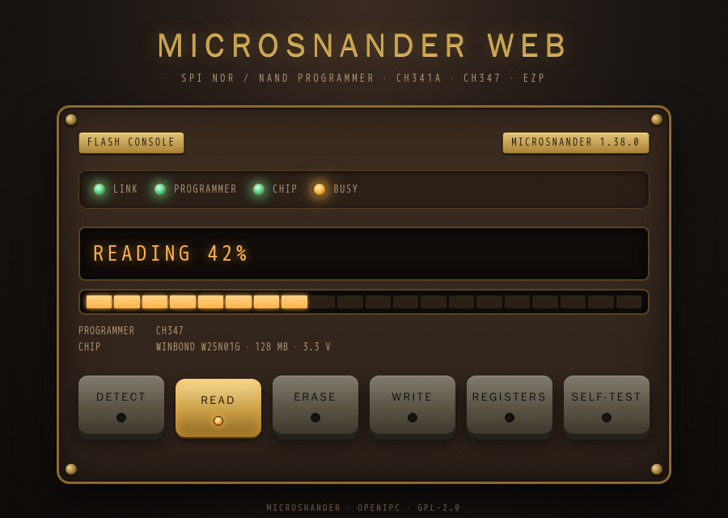
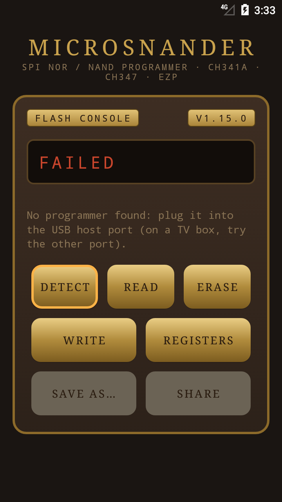
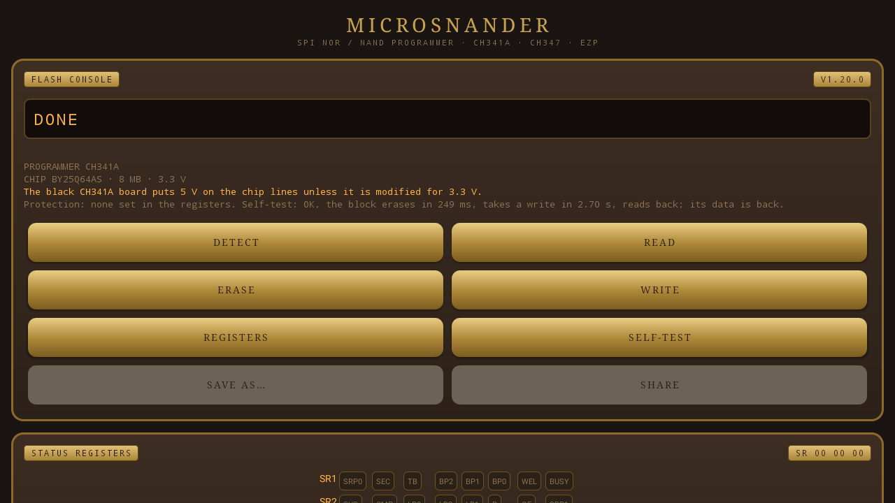

![OpenIPC logo][logo]

# MicroSNANDer

**English** | [Русский](README.ru.md) | [简体中文](README.zh-CN.md)

[](https://github.com/OpenIPC/microsnander/actions/workflows/build.yml)
[](https://github.com/OpenIPC/microsnander/releases/latest)
[](LICENSE)
[](https://github.com/OpenIPC/microsnander)
[](#requirements)

MicroSNANDer is a programmer for SPI NOR and SPI NAND flash chips with the cheap CH341A,
CH347 and EZP USB programmers, six models in all: a command-line tool with a web page
built in, and an Android app. It reads, writes, erases and verifies the flash of cameras,
routers and other boards, removes the write protection of SPI NOR chips, and knows 291
SPI NOR and 135 SPI NAND chips. Each release file is about 200–240 KB.

It is a stripped-down, extended, deeply modified and optimized version of
[SNANDer](https://github.com/McMCCRU/SNANDer) 1.7.4 by McMCC: Linux only, SPI NOR
and SPI NAND only (no EEPROM chips), with the `-u` (unprotect) command and the
flash chips found on OpenIPC hardware added. The release binaries are static and
have no dependencies, so the same file runs on a PC or right on an ARM camera
with the programmer plugged into its USB port.

Changes: [CHANGELOG.md](CHANGELOG.md).

## Quick start

```sh
# 1. Download the static binary (arm: microsnander-linux-arm)
curl -fLo microsnander https://github.com/OpenIPC/microsnander/releases/latest/download/microsnander-linux-x86_64
chmod +x microsnander

# 2. Plug in the programmer with the chip, detect it
sudo ./microsnander -i

# 3. Back up the whole chip, then write a new image and verify it
sudo ./microsnander -r backup.bin
sudo ./microsnander -w firmware.bin -v
```

## Contents

- [Quick start](#quick-start)
- [Why MicroSNANDer](#why-microsnander)
- [Requirements](#requirements)
- [Programmers compared](#programmers-compared)
- [Releases and permanent links](#releases-and-permanent-links)
- [Usage](#usage)
- [Examples](#examples)
- [Web mode](#web-mode)
- [Android app](#android-app)
- [Supported chips](#supported-chips)
- [Chip voltage](#chip-voltage)
- [Chips with uncertain data](#chips-with-uncertain-data)
- [Build](#build)
- [Credits](#credits)
- [License](#license)
- [Support](#support)

## Why MicroSNANDer

On a desktop, with a programmer and a chip at hand, other programs do the job well, many of
them with a graphical interface. MicroSNANDer is made for the places they do not reach:

- **One small file.** A release file of about 200–240 KB holds everything: SPI NOR and SPI
  NAND, the chip list, the drivers of all six programmers (CH341A, CH347T, CH347F, EZP2019,
  EZP2019+, EZP2023) and the web page.
- **Nothing to install.** No kernel driver for the programmer, no libc and no libusb on the
  system: the Linux binaries are static and reach the programmer through the USB support of
  the kernel.
- **Runs on the device at hand.** A Linux board with a USB host port is enough, x86_64 or
  32-bit ARM: repairing a device, a working one of the same kind can flash the chip of the
  broken one, with no PC nearby.
- **No desoldering.** With a clip on the chip, the flash of a board is read and written in
  place.
- **Help from a distance.** With [web mode](#web-mode) the person at the bench connects the
  programmer, and a specialist elsewhere sees the progress and runs the operations from a
  browser. It is the same file, so it works on a board with no screen.
- **A phone is a programmer.** The [Android app](#android-app) works with all of them on a
  phone or a TV box, Android 5.0 and later, without root.

Windows and macOS are not supported and will not be, but you can still work from them: plug
the programmer into another device that runs microsnander (a router, a computer, a camera, a
TV box on Linux) and open its [web page](#web-mode) or log in to it over SSH. If that does not
suit you, or for EEPROM chips, which MicroSNANDer does not handle, use a native program.

## Requirements

- A USB programmer with a socket or a clip for the chip:
  - CH341A (USB ID `1a86:5512`) in SPI mode (the jumper on the programmer board).
    The data lines of the common black CH341A board are at 5 V: use a 3.3 V modified
    board or a level adapter for 3.3 V chips, and a 1.8 V adapter for 1.8 V chips.
  - CH347T (`1a86:55db`) in mode 1 (UART + SPI + I2C, set by its mode switch or
    jumpers) or CH347F (`1a86:55de`). Much faster than the CH341A (a 16 MB chip reads in about 7 s); the SPI
    clock is 30 MHz, `-S` changes it.
  - EZP2019, EZP2019+ or EZP2023 (USB `1fc8:310b`, `1fc8:310c` or `1fc8:310d`), for SPI NOR
    chips up to 16 MB. These programmers run the SPI bus in their own firmware and
    take only whole operations, so with them:
    - `-r`, `-w` and `-v` work as with the others (a 16 MB chip reads in about 2 min 15 s);
    - `-e` erases only the whole chip: give it without `-a` and `-l`, erasing a part
      is refused;
    - `-w` writes only to an erased range: it reads the range first and refuses to
      write over data;
    - the status registers can be neither read nor written: no `-u`, and the
      detection does not show them;
    - no SPI NAND, and none will come: their firmware works with SPI NOR only (it reads even
      the chip ID as a NOR chip, so a SPI NAND answers with a shifted ID), and the maker lists
      only SPI NOR and EEPROM chips for them. Use the CH341A or the CH347 for SPI NAND.

  With one programmer connected microsnander uses it; with several, choose one with
  `-P ch341a`, `-P ch347` or `-P ezp`. A kernel driver that has taken the programmer (for
  example `spi-ch341`) is detached for the run and attached back after it.
- Linux on x86_64 or 32-bit ARM (ARMv5TE and later). The release binaries are
  static (musl), without libusb: microsnander talks to the programmers through the Linux
  usbfs (`/dev/bus/usb`) itself. Nothing to install: no kernel driver for the programmer
  is needed, only USB host support in the kernel and the device nodes in `/dev/bus/usb`.
- Access to the USB device: run as root, or allow it to a group with a udev rule
  (then replug the programmer):

  ```sh
  sudo tee /etc/udev/rules.d/60-microsnander.rules <<'EOF'
  SUBSYSTEM=="usb", ATTR{idVendor}=="1a86", ATTR{idProduct}=="5512", MODE="0660", GROUP="plugdev"
  SUBSYSTEM=="usb", ATTR{idVendor}=="1a86", ATTR{idProduct}=="55db", MODE="0660", GROUP="plugdev"
  SUBSYSTEM=="usb", ATTR{idVendor}=="1a86", ATTR{idProduct}=="55de", MODE="0660", GROUP="plugdev"
  SUBSYSTEM=="usb", ATTR{idVendor}=="1fc8", ATTR{idProduct}=="310b", MODE="0660", GROUP="plugdev"
  SUBSYSTEM=="usb", ATTR{idVendor}=="1fc8", ATTR{idProduct}=="310c", MODE="0660", GROUP="plugdev"
  SUBSYSTEM=="usb", ATTR{idVendor}=="1fc8", ATTR{idProduct}=="310d", MODE="0660", GROUP="plugdev"
  EOF
  sudo usermod -aG plugdev "$USER"
  sudo udevadm control --reload-rules && sudo udevadm trigger
  ```

## Programmers compared

Measured with microsnander 1.14.1 on Linux, with the same chip in each programmer (Winbond
W25Q128, 16 MB): the time of the whole command, from the start to `Status: OK`. Before a
write, the EZP programmers read the range to check that it is erased.

|                                    | CH341A      | CH347T / CH347F                        | EZP2019 / EZP2019+ / EZP2023            |
|------------------------------------|-------------|----------------------------------------|-----------------------------------------|
| USB ID                             | `1a86:5512` | `1a86:55db`, `1a86:55de`               | `1fc8:310b`, `310c`, `310d`             |
| SPI clock                          | fixed       | 1.875–60 MHz (`-S`), 30 MHz by default | set by its firmware                     |
| SPI NOR                            | yes         | yes                                    | up to 16 MB                             |
| SPI NAND                           | yes         | yes                                    | no                                      |
| Erase a part of the chip           | yes         | yes                                    | no, the whole chip only                 |
| Unprotect (`-u`), status registers | yes         | yes                                    | no                                      |
| Chip erase, 16 MB                  | 48 s        | 33 s                                   | 37 s                                    |
| Read 16 MB                         | 136 s       | 7.2 s (5.2 s at 60 MHz)                | 136 s                                   |
| Write 16 MB                        | 256 s       | 152 s                                  | 275 s (of them 136 s: the erased check) |

## Releases and permanent links

There is one release, [`latest`](https://github.com/OpenIPC/microsnander/releases/latest).
CI rebuilds it from every push to `main` once all builds pass; its title carries the
version (`Microsnander X.Y.Z`), and no versioned releases are kept. The file names
have no version, so these links always give the newest build:

| File                                                                                                                      | For                                                                                          |
|---------------------------------------------------------------------------------------------------------------------------|----------------------------------------------------------------------------------------------|
| [`microsnander-linux-x86_64`](https://github.com/OpenIPC/microsnander/releases/latest/download/microsnander-linux-x86_64) | PCs and servers                                                                              |
| [`microsnander-linux-arm`](https://github.com/OpenIPC/microsnander/releases/latest/download/microsnander-linux-arm)       | 32-bit ARM: cameras, Raspberry Pi and other boards (soft-float, runs with or without an FPU) |
| [`microsnander-android.apk`](https://github.com/OpenIPC/microsnander/releases/latest/download/microsnander-android.apk)   | Android 5.0 and later: phones and TV boxes with a USB host port, no root                     |

Release page: `https://github.com/OpenIPC/microsnander/releases/latest`

## Usage

```
microsnander [options]

 -h             display this message
 -d             disable internal ECC (use read and write page size + OOB size)
 -I             ECC ignore errors (for read test only)
 -k             skip BAD pages (SPI NAND): use the next page instead
 -L             print list support chips
 -i             read the chip ID info
 -e             erase chip (full or use with -a [-l])
 -l <bytes>     manually set length
 -a <address>   manually set address
 -w <filename>  write chip with data from filename
 -r <filename>  read chip and save data to filename
 -u             unprotect chip; -uu: also clear QE (quad enable), a chip of a
                board that boots in quad mode may then not boot
 -t             self-test: protection, then erase, write and read back one block
                (the first; -a for another) and put its data back
 -v             verify after write on chip
 -P <name>      programmer: ch341a, ch347, ezp, auto (default: the one connected)
 -S <speed>     SPI clock of the CH347: 60M, 30M (default), 15M, 7.5M, 3.75M, 1.875M
 -W [addr:]port web mode: a page with Detect, Read, Erase, Write, Registers
 -K <password>  web mode: ask for this password (any user name)
 -o <dir>       web mode: where Read saves the dumps (default: the current one)
```

One operation per run: `-i`, `-e`, `-r`, `-w`, `-u` or `-t`. Without `-a` and `-l` the
operation covers the whole chip. Addresses and lengths are decimal or hex with
`0x`. Erase works on whole blocks: the length must be a multiple of the block size
the chip reports.

SPI NAND chips are read and written with their internal ECC by default: the file
holds the data pages only. With `-d` the ECC is off and every page is read and
written with its OOB (spare) area, for a raw dump.

With `-k` a page that fails ECC on read or fails to program is skipped and the
data goes on in the next page, so everything after it shifts by a page; each
skipped page is printed. A write stays inside `-a`/`-l` (without `-l`, up to the
chip end): give `-l` the size of the partition, and a write that needs more room
than that fails. A read that would need a page past the chip end fails. A page that failed to program is remembered only for `-v` in the same run:
a later `-k` read may read it as data, and the dump is shifted from there on.

`-u` clears the protection bits and keeps QE (quad enable), which protects nothing. `-uu`
clears QE as well, SPI NOR on the command line only. QE turns the WP# and HOLD# pins into data
lines, and a board that reads the chip in quad mode may not boot without it. Some chips have
it fixed at the factory: then `-uu` says that it stays.

`-t` is a quick check of the chip, with nothing to prepare: it reads the protection bits
(SPI NOR: BP, TB, CMP, SRP in the status registers; SPI NAND: the block lock register), then
takes one block — the first by default, where a locked loader usually is, or the one at `-a` —
keeps its data, erases it, writes a pattern, reads it back and puts the old data back. It ends
with one line: `OK` (exit 0), `PROTECTED` (exit 2) or `FAILED` with the address of the first
wrong byte (exit 1). `PROTECTED` comes before anything is erased when the protection bits are
set (they stay as they are: `-u` clears them, then `-t` again), or when the block takes the
commands and keeps its data with no bit set (the WP# pin, a block lock). If the old data
cannot be put back, it is saved to `selftest-<chip>-0x<address>.bin` next to it. SPI NAND is
tested on block 0 only, the one every maker guarantees good, and its spare area besides the ECC
is not kept. `-t` goes without `-d`, `-I` and `-k`. The EZP programmers erase only the whole
chip: with them `-t` reads the block twice and does not erase it.

## Examples

```sh
# Chip ID, name and size
microsnander -i

# Self-test: is the chip protected, does its first block erase, take a write and read back
microsnander -t

# Full backup
microsnander -r full.bin

# 1 MiB from 0x50000 (for example, a kernel partition)
microsnander -r kernel.bin -a 0x50000 -l 0x100000

# Write a full image and verify it
microsnander -w full.bin -v

# Write U-Boot only, to the start of the chip
microsnander -w u-boot.bin -a 0 -v

# Erase 64 KiB at 0x40000 (one block of most SPI NOR chips)
microsnander -e -a 0x40000 -l 0x10000

# SPI NOR chip that refuses to erase or write: remove the protection first
microsnander -u

# SPI NAND: raw dump with the OOB area, ECC off
microsnander -d -r raw.bin
```

## Web mode

`-W [address:]port` runs microsnander as a service: a page in the browser, in the style of
the other OpenIPC tools, with Detect, Read, Erase, Write and Registers for the programmer that
is connected. It is for a board with no screen, and for help from a distance: the person at the
bench connects the programmer and the chip, and a specialist elsewhere opens the page, sees the
progress and runs the operations.

<p align="center">
  
  
  
</p>

```sh
microsnander -W 8080                       # every interface, port 8080
microsnander -W 127.0.0.1:8080 -K secret   # this computer only, with a password
microsnander -P ch347 -W 8080 -o /srv/dumps
```

The page:

- **Lamps**: Link (the page reaches the service), Programmer, Chip, Busy.
- **Gauge and display**: the progress of the operation in percent and its state (Reading,
  Writing, Verifying, Erasing, Saved, Written, Erased, Failed); under them the programmer,
  the chip and its size, the last dump and the last message.
- **Detect**: finds the programmer and the chip, and reads the status registers.
- **Read**: the whole chip into a file in the `-o` directory (the current one by default),
  which the browser downloads too; the link stays on the page. With `-a`/`-l` given at the
  start, Read takes that range.
- **Erase**: the whole chip, after a confirmation.
- **Write**: a file chosen in the browser (a loader or a full image) is written from address 0
  into an erased chip, then read back and compared. Erase first. The file is not kept in memory:
  it waits, without a name, in the `-o` directory, so an image of up to 512 MB needs that much
  free disk space there.
- **Registers**: a lamp for every bit of status registers 1–3 (bit names as on Winbond-type
  chips; amber: a protection bit, green: another bit) and **Clear protection**, which does
  what `-u` does: it clears BP, SRP and CMP and keeps QE. SPI NOR through the CH341A or the
  CH347 only; the EZP programmers cannot read the registers.
- **Self-test**: `-t` on the first block (see [Usage](#usage)) — Detect first, then the
  question naming the chip found; the verdict (`OK`, `PROTECTED`, `FAILED`) and the protection
  are the message. A block that does not come back is saved in the `-o` directory.

File names: `flash-YYYYMMDDHHMM-CHIP.bin` in the local time of the machine that runs the
service, for example `flash-202611031706-W25Q128BV.bin`. With `-a`/`-l` the range is added:
`flash-202611031706-W25Q128BV-0x50000-0x100000.bin`. A second read in the same minute does not
replace the first one: it gets `-2`, `-3` and so on.

How it works:

- One programmer is used, chosen as without `-W`; with several connected, give `-P`.
- The programmer is opened for each operation and closed after it, so between operations it
  can be replugged, or used by a normal microsnander run.
- One operation runs at a time; a request while one runs gets `409`. The page polls the state
  twice a second while an operation runs.
- `-W` takes no operation of its own (`-i`, `-r`, `-w`, `-e`, `-u`, `-t`) and no `-v`, `-S`, `-d`,
  `-I` or `-k`: the page does the operations, writes whole files from address 0 with ECC on
  and always verifies. `-K` and `-o` go with `-W` only.
- The service keeps running when a client disconnects; a slow client does not hold the others
  (up to 16 connections at a time).

Access:

- Without `-K` anyone who reaches the port can erase the chip. With `-K` the browser asks for
  the password (any user name); an empty password is refused.
- The page is plain HTTP, so the password crosses the network unencrypted: use a trusted
  network, or `-W 127.0.0.1:8080` and an SSH tunnel.
- Operations need a header that only the page sends, so a page of another site cannot start an
  erase or a write. A request has to name this machine by its IP address, `localhost` or its
  host name (no other names: DNS rebinding).
- For help over the internet use an SSH tunnel: `microsnander -W 127.0.0.1:8080 -K secret` on the
  machine with the programmer, so that the port stays closed to the network, then
  `ssh -L 8080:127.0.0.1:8080 user@machine` and `http://127.0.0.1:8080/` on the specialist's side.
  The tunnel is encrypted. A plain forwarded port without it is not: the password and the firmware
  cross the internet in the clear, and it works by the IP address only, because a domain name
  (dynamic DNS, a tunnel service) is refused, as above.
- Only dumps made by Read are served from the `-o` directory, never links to other files.

As a systemd service (the user in the `plugdev` group of the udev rule above):

```ini
# /etc/systemd/system/microsnander.service
[Unit]
Description=microsnander web mode
After=network.target

[Service]
ExecStart=/usr/local/bin/microsnander -W 8080 -K <password> -o /var/lib/microsnander
User=microsnander
Group=plugdev
StateDirectory=microsnander
Restart=on-failure

[Install]
WantedBy=multi-user.target
```

## Android app

`android/` is an app with the same buttons as the web mode — Detect, Read, Erase, Write,
Registers — for a CH341A, CH347 or EZP programmer on the USB host port of a phone or an
Android TV box (Android 5.0 and later, no root; on a TV box it is on the home screen and works
with the remote).

<p align="center">
  
  
</p>

- Plug the programmer in (through an OTG adapter on a phone; on a TV box one of its ports may
  be a device port only — try the other) and allow the app to use it.
- **Read** saves `flash-YYYYMMDDHHMM-CHIP.bin` to Downloads; **Save as…** puts it anywhere,
  **Share** sends it to another app.
- **Write** takes a file from the file picker and writes it from address 0 into an erased chip,
  then verifies it; the file is read in parts, not held in memory. **Erase** erases the whole chip.
- **Registers** and **Clear protection** as in the web mode (SPI NOR through the CH341A or the
  CH347), and **Self-test** (`-t` on the first block, after Detect and a question).
- The app runs the same C code as microsnander (`src/`), built with the NDK, on the device the
  Android USB manager opened (its file descriptor, through the usbfs code, no libusb). The signed APK is in the release:
  `microsnander-android.apk` in [latest](https://github.com/OpenIPC/microsnander/releases/latest).

Build: `cd android && gradle assembleDebug` with the Android SDK and NDK r27c.

## Supported chips

`microsnander -L` prints the list: 291 SPI NOR chips (Winbond, Eon, Fudan
Microelectronics FM25Q, GigaDevice, Macronix, Spansion, XMC, XTX, Zbit, Giantec
GM25Q, ISSI, Micron, Boya, Puya and others) and 135 SPI NAND chips (Etron, GigaDevice, Heyang, Foresee, ESMT, Dosilicon, XTX,
Micron, Toshiba/Kioxia, Winbond, Macronix and others).
A chip that is not on the list is reported as not detected; its ID from the
output helps to add it.

## Chip voltage

The programmers work at 3.3 V. The programmer does not measure the voltage, so microsnander
takes it from the chip name: 56 SPI NOR chips of the list are 1.8 V parts (GigaDevice GD25L,
Macronix MX25U, Winbond W25Q..W, Micron N25Q..A11 and MT25QU, XMC XM25QU and XM25LU, Zbit
ZB25LQ, Boya BY25Q..L, ISSI IS25WP), and so are 20 SPI NAND chips (GigaDevice GD5F..R, Winbond
W25N..W, Macronix MX35UF, Micron MT29F..ABB, ESMT F50D, Dosilicon DS35M). Connect them through
a 1.8 V adapter: at 3.3 V the reads are not reliable and the chip can be damaged.
GigaDevice GD25W, XMC XM25QW and Fudan FM25W take 1.65-3.6 V and work as they are.

After a 1.8 V chip is found, the console prints a warning, the web page lights the Chip lamp
red and shows the warning, and so does the Android app; `/api/state` has the `voltage` (`3.3`,
`1.8`, `1.65-3.6`) and the `warning`. A chip that is not on these lists is taken for 3.3 V.

There are no 5 V SPI flash chips. The black CH341A board, though, puts 5 V on the chip lines
unless it is modified for 3.3 V, and the program cannot see that: with the CH341A, microsnander
reminds about it every time it finds a chip.

## Chips with uncertain data

For the SPI NOR and SPI NAND chips below, other sources give different parameters than the
ones MicroSNANDer uses. None of them has been checked on hardware yet, so reading,
writing and especially raw dumps (`-d`) may behave differently from what is
described here. If you have one of these chips, please report how it works in
[GitHub Issues](https://github.com/OpenIPC/microsnander/issues), with the output
of `microsnander -i` and the full part number from the chip.

| Chip                                                      | MicroSNANDer uses                                                                       | Found elsewhere                                                     |
|-----------------------------------------------------------|-----------------------------------------------------------------------------------------|---------------------------------------------------------------------|
| TOSHIBA TC58CVG0S3H, TC58CVG1S3H                          | OOB 128 bytes                                                                           | OOB 64 bytes                                                        |
| TOSHIBA TC58CVG2S0H, KIOXIA TC58CVG2S0HRAIJ               | OOB 256 bytes                                                                           | OOB 128 bytes                                                       |
| MICRON MT29F4G01 (ID `2C 36`)                             | two 2 Gbit dies, page 2 KB, OOB 128 bytes                                               | one die, page 4 KB, OOB 256 bytes                                   |
| HEYANG chips with maker ID `C9`                           | uncorrectable ECC = `10` in status bits 5:4; unlock clears bits 5:3                     | `11` in bits 5:4; unlock bits 6:3                                   |
| DOSILICON DS35Q1GA, DS35Q2GA                              | uncorrectable ECC = `10` in status bits 5:4                                             | `010` in bits 6:4                                                   |
| GIGADEVICE GD5F1GM7UE                                     | OOB 128 bytes, dual read                                                                | OOB 64 bytes, single read                                           |
| ESMT F50D1G41LB(2M)                                       | OOB 64 bytes                                                                            | OOB 128 bytes                                                       |
| FORESEE F35SQA001G                                        | OOB 64 bytes                                                                            | OOB 128 bytes                                                       |
| FORESEE F35SQA512M                                        | dual read                                                                               | single read                                                         |
| XINCUN XCSP1AAWH-NT                                       | no ECC status check: an uncorrectable page is read without an error                     | the encoding of its status is unknown                               |
| UNIM UM19C0HISW                                           | not supported yet                                                                       | a geometry with the spare area counted into the page and block size |
| ES25P10–ES25P32, ES25M40A–ES25M16A (SPI NOR)              | size from the capacity byte of the ID (ES25P10: 1 Mbit)                                 | twice that size                                                     |
| ISSI `9D 60 1A`, `9D 70 1A` (SPI NOR)                     | IS25LP512M, IS25WP512M, 512 Mbit                                                        | named IS25LP256D, IS25WP256D                                        |
| PCT25VF020B–PCT25VF032B, PCT26VF016, PCT26VF032 (SPI NOR) | AAI word program (SST25 type), ULBPR unlock and 4 KB erase (SST26 type); slow on CH341A | listed as ordinary chips with a 256-byte page program               |
| PCT25VF010A (SPI NOR)                                     | not supported: no JEDEC READ ID                                                         | listed with a JEDEC ID                                              |

The OOB size matters for raw dumps with `-d` (every page is read with its spare
area); reading and writing with the internal ECC uses only the data area. A raw
write takes whole pages of data + OOB only, so a raw dump of the Toshiba/Kioxia chips
above made before version 1.11.1 (with the old OOB size) is refused: pad each of its
pages with `0xFF` to the new OOB size first.

## Build

Native build (Debian, Ubuntu): no libraries are needed, the programmers are reached through
the Linux usbfs by `src/usbfs.c`:

```sh
sudo apt-get install build-essential
make -C src
```

`make -C src LIBUSB=1` builds against libusb-1.0 instead (`libusb-1.0-0-dev`), for comparison.

I2C (24Cxx) and Microwire (93Cxx) EEPROM chips are not supported: microsnander is for
SPI NOR and SPI NAND flash. The EEPROM part of the original SNANDer (`-E`, `-8`, `-f`)
was removed.

The static release binaries are built by `ci/build-musl.sh` (Docker or any Linux
x86_64 host with `curl`, `make` and, for arm, `qemu-user`). It downloads the musl
toolchain and checks it by SHA256:

```sh
ci/build-musl.sh x86_64 dist    # dist/microsnander-linux-x86_64
ci/build-musl.sh arm dist       # dist/microsnander-linux-arm
```

## Credits

MicroSNANDer is based on [SNANDer](https://github.com/McMCCRU/SNANDer)
by McMCC (Serial Nor/nAND/Eeprom programmeR), which builds on the CH341A code of
flashrom and ch341eeprom. The original copyrights are kept in the source files.

## License

[GPL-2.0](LICENSE), as the original SNANDer. See [LICENSE](LICENSE) for the full terms.

## Support

- Questions and bug reports: [GitHub Issues](https://github.com/OpenIPC/microsnander/issues)
- Documentation: [openipc.org](https://openipc.org)

[](https://openipc.org/our-channels)

[logo]: https://raw.githubusercontent.com/OpenIPC/.github/refs/heads/main/assets/openipc-logo-black.svg
