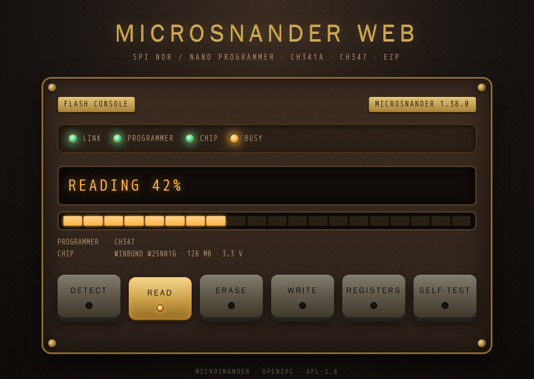
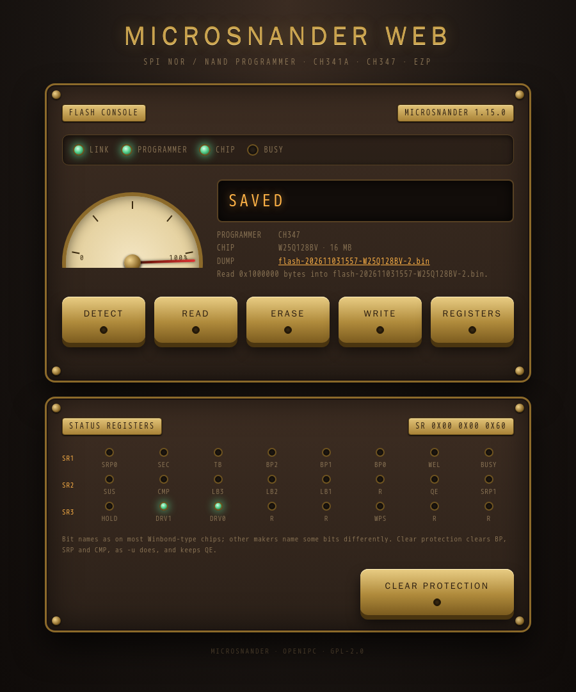
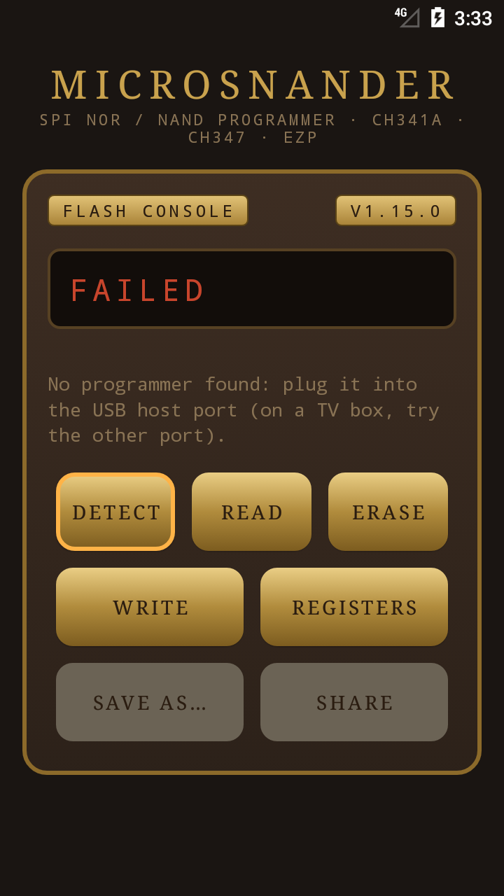
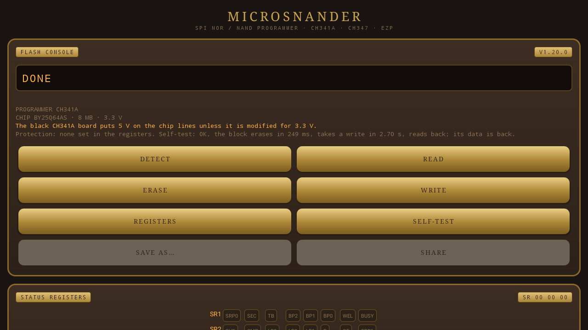

![OpenIPC logo][logo]

# MicroSNANDer

[English](README.md) | **Русский** | [简体中文](README.zh-CN.md)

[](https://github.com/OpenIPC/microsnander/actions/workflows/build.yml)
[](https://github.com/OpenIPC/microsnander/releases/latest)
[](LICENSE)
[](https://github.com/OpenIPC/microsnander)
[](#требования)

MicroSNANDer — консольный программатор микросхем флеш-памяти SPI NOR и SPI NAND
для недорогих USB-программаторов CH341A, CH347 и EZP. Он читает, записывает, стирает и проверяет
флеш камер, роутеров и других плат, снимает защиту от записи с микросхем SPI NOR и
знает 291 микросхему SPI NOR и 135 микросхем SPI NAND.

Это урезанная, дополненная, глубоко модифицированная и оптимизированная версия
[SNANDer](https://github.com/McMCCRU/SNANDer) 1.7.4 от McMCC: только Linux, без поддержки EEPROM, с командой
`-u` (снятие защиты) и микросхемами флеш-памяти, которые встречаются в оборудовании
OpenIPC. Релизные файлы статические и без зависимостей, поэтому один и тот же файл
работает и на ПК, и прямо на ARM-камере с программатором в её USB-порту.

Изменения: [CHANGELOG.md](CHANGELOG.md).

## Быстрый старт

```sh
# 1. Скачать статический файл (для arm: microsnander-linux-arm)
curl -fLo microsnander https://github.com/OpenIPC/microsnander/releases/latest/download/microsnander-linux-x86_64
chmod +x microsnander

# 2. Подключить программатор с микросхемой и определить её
sudo ./microsnander -i

# 3. Сохранить копию всей микросхемы, затем записать новый образ с проверкой
sudo ./microsnander -r backup.bin
sudo ./microsnander -w firmware.bin -v
```

## Содержание

- [Быстрый старт](#быстрый-старт)
- [Требования](#требования)
- [Сравнение программаторов](#сравнение-программаторов)
- [Релизы и постоянные ссылки](#релизы-и-постоянные-ссылки)
- [Использование](#использование)
- [Примеры](#примеры)
- [Веб-режим](#веб-режим)
- [Приложение для Android](#приложение-для-android)
- [Поддерживаемые микросхемы](#поддерживаемые-микросхемы)
- [Напряжение микросхем](#напряжение-микросхем)
- [Микросхемы с неточными данными](#микросхемы-с-неточными-данными)
- [Сборка](#сборка)
- [Благодарности](#благодарности)
- [Лицензия](#лицензия)
- [Поддержка](#поддержка)

## Требования

- USB-программатор с панелькой или клипсой для микросхемы:
  - CH341A (USB ID `1a86:5512`) в режиме SPI (перемычка на плате программатора).
    Линии данных у распространённой чёрной платы CH341A работают на 5 В: для микросхем
    на 3,3 В нужна доработанная плата на 3,3 В или преобразователь уровней, для
    микросхем на 1,8 В — переходник на 1,8 В.
  - CH347T (`1a86:55db`) в режиме 1 (UART + SPI + I2C, переключатель или перемычки
    режима) или CH347F (`1a86:55de`). Намного быстрее CH341A (16 МБ читаются примерно за 7 с); частота SPI —
    30 МГц, её меняет `-S`.
  - EZP2019, EZP2019+ или EZP2023 (USB `1fc8:310b`, `1fc8:310c` или `1fc8:310d`), для микросхем
    SPI NOR до 16 МБ. Эти программаторы сами ведут шину SPI в своей прошивке и
    принимают только целые операции, поэтому с ними:
    - `-r`, `-w` и `-v` работают как с остальными (16 МБ читаются примерно за 2 мин 15 с);
    - `-e` стирает только всю микросхему: давайте его без `-a` и `-l`, стирание части
      отклоняется;
    - `-w` пишет только в стёртую область: сначала читает её и отказывается писать
      поверх данных;
    - регистры состояния нельзя ни прочитать, ни записать: нет `-u`, при определении
      микросхемы они не показываются;
    - SPI NAND не поддерживается.

  Если подключён один программатор, microsnander работает с ним; если несколько —
  выберите нужный ключом `-P ch341a`, `-P ch347` или `-P ezp`. Драйвер ядра, занявший
  программатор (например, `spi-ch341`), на время работы отключается и потом
  возвращается.
- Linux на x86_64 или 32-битном ARM (ARMv5TE и новее). Релизные файлы статические
  (musl), без libusb: с программаторами microsnander работает сам, через usbfs Linux
  (`/dev/bus/usb`). Ставить ничего не нужно.
- Доступ к USB-устройству: запуск от root или правило udev для группы (после него
  переподключите программатор):

  ```sh
  sudo tee /etc/udev/rules.d/60-microsnander.rules <<'EOF'
  SUBSYSTEM=="usb", ATTR{idVendor}=="1a86", ATTR{idProduct}=="5512", MODE="0660", GROUP="plugdev"
  SUBSYSTEM=="usb", ATTR{idVendor}=="1a86", ATTR{idProduct}=="55db", MODE="0660", GROUP="plugdev"
  SUBSYSTEM=="usb", ATTR{idVendor}=="1a86", ATTR{idProduct}=="55de", MODE="0660", GROUP="plugdev"
  SUBSYSTEM=="usb", ATTR{idVendor}=="1fc8", ATTR{idProduct}=="310b", MODE="0660", GROUP="plugdev"
  SUBSYSTEM=="usb", ATTR{idVendor}=="1fc8", ATTR{idProduct}=="310c", MODE="0660", GROUP="plugdev"
  SUBSYSTEM=="usb", ATTR{idVendor}=="1fc8", ATTR{idProduct}=="310d", MODE="0660", GROUP="plugdev"
  EOF
  sudo usermod -aG plugdev "$USER"
  sudo udevadm control --reload-rules && sudo udevadm trigger
  ```

## Сравнение программаторов

Замерено с microsnander 1.14.1 в Linux, в каждом программаторе одна и та же микросхема
(Winbond W25Q128, 16 МБ): время всей команды, от запуска до `Status: OK`. Перед записью
программаторы EZP читают область, чтобы проверить, что она стёрта.

|                                          | CH341A      | CH347T / CH347F                          | EZP2019 / EZP2019+ / EZP2023              |
|------------------------------------------|-------------|------------------------------------------|-------------------------------------------|
| USB ID                                   | `1a86:5512` | `1a86:55db`, `1a86:55de`                 | `1fc8:310b`, `310c`, `310d`               |
| Частота SPI                              | постоянная  | 1,875–60 МГц (`-S`), по умолчанию 30 МГц | задаёт его прошивка                       |
| SPI NOR                                  | да          | да                                       | до 16 МБ                                  |
| SPI NAND                                 | да          | да                                       | нет                                       |
| Стирание части микросхемы                | да          | да                                       | нет, только целиком                       |
| Снятие защиты (`-u`), регистры состояния | да          | да                                       | нет                                       |
| Стирание микросхемы, 16 МБ               | 48 с        | 33 с                                     | 37 с                                      |
| Чтение 16 МБ                             | 136 с       | 7,2 с (5,2 с на 60 МГц)                  | 136 с                                     |
| Запись 16 МБ                             | 256 с       | 152 с                                    | 275 с (из них 136 с — проверка стёртости) |

## Релизы и постоянные ссылки

Релиз один — [`latest`](https://github.com/OpenIPC/microsnander/releases/latest).
CI пересобирает его при каждом push в `main`, когда все сборки прошли; в заголовке
стоит версия (`Microsnander X.Y.Z`), релизов по версиям нет. В именах файлов нет
версии, поэтому эти ссылки всегда ведут на свежую сборку:

| Файл                                                                                                                      | Для чего                                                                                   |
|---------------------------------------------------------------------------------------------------------------------------|--------------------------------------------------------------------------------------------|
| [`microsnander-linux-x86_64`](https://github.com/OpenIPC/microsnander/releases/latest/download/microsnander-linux-x86_64) | ПК и серверы                                                                               |
| [`microsnander-linux-arm`](https://github.com/OpenIPC/microsnander/releases/latest/download/microsnander-linux-arm)       | 32-битный ARM: камеры, Raspberry Pi и другие платы (soft-float, работает с FPU и без него) |
| [`microsnander-android.apk`](https://github.com/OpenIPC/microsnander/releases/latest/download/microsnander-android.apk)   | Android 5.0 и новее: телефоны и приставки с USB host, без root                             |

Страница релиза: `https://github.com/OpenIPC/microsnander/releases/latest`

## Использование

```
microsnander [options]

 -h             display this message
 -d             disable internal ECC (use read and write page size + OOB size)
 -I             ECC ignore errors (for read test only)
 -k             skip BAD pages (SPI NAND): use the next page instead
 -L             print list support chips
 -i             read the chip ID info
 -e             erase chip (full or use with -a [-l])
 -l <bytes>     manually set length
 -a <address>   manually set address
 -w <filename>  write chip with data from filename
 -r <filename>  read chip and save data to filename
 -u             unprotect chip
 -v             verify after write on chip
 -P <name>      programmer: ch341a, ch347, ezp, auto (default: the one connected)
 -S <speed>     SPI clock of the CH347: 60M, 30M (default), 15M, 7.5M, 3.75M, 1.875M
 -W [addr:]port web mode: a page with Detect, Read, Erase, Write, Registers
 -K <password>  web mode: ask for this password (any user name)
 -o <dir>       web mode: where Read saves the dumps (default: the current one)
```

За один запуск — одна операция: `-i`, `-e`, `-r`, `-w` или `-u`. Без `-a` и `-l`
операция идёт по всей микросхеме. Адреса и длины — десятичные или шестнадцатеричные
с `0x`. Стирание идёт целыми блоками: длина должна быть кратна размеру блока, который
сообщает микросхема.

Микросхемы SPI NAND по умолчанию читаются и пишутся со встроенным ECC: в файле
только страницы данных. С `-d` ECC выключен, и каждая страница читается и пишется
вместе с областью OOB (spare) — для «сырого» дампа.

С `-k` страница, которая не читается из-за ошибки ECC или не записывается,
пропускается, и данные идут дальше со следующей страницы, поэтому всё после неё
сдвигается на страницу; каждая пропущенная страница выводится. Запись не выходит
за `-a`/`-l` (без `-l` — до конца микросхемы): укажите в `-l` размер раздела, и
запись, которой не хватит места в нём, завершится ошибкой. Чтение, которому нужна
страница за концом микросхемы, тоже завершается ошибкой. Страница, которая не
записалась, запоминается только для `-v` в том же запуске: позднее чтение с `-k`
может прочитать её как данные, и дамп с этого места сдвинется.

## Примеры

```sh
# ID микросхемы, название и размер
microsnander -i

# Полная копия
microsnander -r full.bin

# 1 МиБ с адреса 0x50000 (например, раздел ядра)
microsnander -r kernel.bin -a 0x50000 -l 0x100000

# Записать полный образ с проверкой
microsnander -w full.bin -v

# Записать только U-Boot в начало микросхемы
microsnander -w u-boot.bin -a 0 -v

# Стереть 64 КиБ с адреса 0x40000 (один блок у большинства SPI NOR)
microsnander -e -a 0x40000 -l 0x10000

# Микросхема SPI NOR не стирается и не пишется: сначала снять защиту
microsnander -u

# SPI NAND: «сырой» дамп с областью OOB, ECC выключен
microsnander -d -r raw.bin
```

## Веб-режим

`-W [адрес:]порт` запускает microsnander как службу: страница в браузере, в стиле других
инструментов OpenIPC, с кнопками Detect, Read, Erase, Write и Registers для подключённого
программатора.

<p align="center">
  
  
</p>

```sh
microsnander -W 8080                       # все интерфейсы, порт 8080
microsnander -W 127.0.0.1:8080 -K secret   # только этот компьютер, с паролем
microsnander -P ch347 -W 8080 -o /srv/dumps
```

Страница:

- **Лампы**: Link (страница видит службу), Programmer, Chip, Busy.
- **Прибор и дисплей**: прогресс операции в процентах и её состояние (Reading, Writing,
  Verifying, Erasing, Saved, Written, Erased, Failed); под ними программатор, микросхема и её
  размер, последний дамп и последнее сообщение.
- **Detect** — находит программатор и микросхему, читает регистры состояния.
- **Read** — вся микросхема в файл в каталоге `-o` (по умолчанию текущий); браузер сразу его
  скачивает, ссылка остаётся на странице. Если при запуске заданы `-a`/`-l`, читается эта
  область.
- **Erase** — стирание всей микросхемы, после подтверждения.
- **Write** — файл, выбранный в браузере (загрузчик или полный образ), пишется с адреса 0 в
  стёртую микросхему, затем читается обратно и сравнивается. Сначала — Erase. Файл не держится
  в памяти: до записи он лежит без имени в каталоге `-o`, поэтому для образа до 512 МБ там нужно
  столько же свободного места.
- **Registers** — лампа на каждый бит регистров состояния 1–3 (названия битов — как у
  микросхем типа Winbond; янтарная — бит защиты, зелёная — другой бит) и **Clear protection**,
  которая делает то же, что `-u`: снимает BP, SRP и CMP и не трогает QE. Только SPI NOR через
  CH341A или CH347; программаторы EZP регистры не читают.

Имена файлов: `flash-ГГГГММДДЧЧММ-МИКРОСХЕМА.bin` по местному времени машины, где работает
служба, например `flash-202611031706-W25Q128BV.bin`. С `-a`/`-l` добавляется область:
`flash-202611031706-W25Q128BV-0x50000-0x100000.bin`. Второе чтение в ту же минуту не заменяет
первое: получает `-2`, `-3` и так далее.

Как устроено:

- Работает один программатор, выбранный так же, как без `-W`; если подключено несколько,
  укажите `-P`.
- Программатор открывается на каждую операцию и закрывается после неё: между операциями его
  можно переподключить или работать с ним обычным запуском microsnander.
- Операции идут по одной; запрос во время операции получает `409`. Пока операция идёт,
  страница спрашивает состояние два раза в секунду.
- С `-W` не задаются свои операции (`-i`, `-r`, `-w`, `-e`, `-u`) и ключи `-v`, `-S`, `-d`, `-I`,
  `-k`: операции делает страница, пишет целые файлы с адреса 0 с включённым ECC и всегда
  проверяет запись. `-K` и `-o` — только вместе с `-W`.
- Служба продолжает работать, когда клиент отключается; медленный клиент не держит остальных
  (до 16 соединений одновременно).

Доступ:

- Без `-K` стереть микросхему может любой, кто достучится до порта. С `-K` браузер спрашивает
  пароль (имя пользователя — любое); пустой пароль не принимается.
- Страница работает по обычному HTTP, и пароль идёт по сети незашифрованным: используйте
  доверенную сеть или `-W 127.0.0.1:8080` и SSH-туннель.
- Операции требуют заголовка, который отправляет только сама страница, так что страница
  другого сайта не может запустить стирание или запись. Запрос должен обращаться к машине по
  IP-адресу, `localhost` или её имени (других имён нет: защита от DNS rebinding).
- Из каталога `-o` отдаются только дампы, сделанные Read, и никогда — ссылки на другие файлы.

Как служба systemd (пользователь — в группе `plugdev` из правила udev выше):

```ini
# /etc/systemd/system/microsnander.service
[Unit]
Description=microsnander web mode
After=network.target

[Service]
ExecStart=/usr/local/bin/microsnander -W 8080 -K <password> -o /var/lib/microsnander
User=microsnander
Group=plugdev
StateDirectory=microsnander
Restart=on-failure

[Install]
WantedBy=multi-user.target
```

## Приложение для Android

`android/` — приложение с теми же кнопками, что в веб-режиме: Detect, Read, Erase, Write,
Registers, для программатора CH341A, CH347 или EZP на USB-порту телефона или приставки
Android TV (Android 5.0 и новее, без root; на приставке оно есть на главном экране и
управляется пультом).

<p align="center">
  
  
</p>

- Подключите программатор (к телефону — через OTG-переходник; на приставке один из портов может
  работать только как устройство — попробуйте другой) и разрешите приложению работать с ним.
- **Read** сохраняет `flash-ГГГГММДДЧЧММ-МИКРОСХЕМА.bin` в «Загрузки»; **Save as…** — куда
  угодно, **Share** отправляет файл в другое приложение.
- **Write** берёт файл через выбор файлов и пишет его с адреса 0 в стёртую микросхему, затем
  проверяет; файл читается частями, целиком в память не загружается. **Erase** стирает всю
  микросхему.
- **Registers** и **Clear protection** — как в веб-режиме (SPI NOR через CH341A или CH347).
- Приложение работает на том же коде C, что и microsnander (`src/`), собранном NDK, с устройством,
  которое открыл менеджер USB Android (через его файловый дескриптор и код usbfs, без libusb). Подписанный APK — в релизе:
  `microsnander-android.apk` в [latest](https://github.com/OpenIPC/microsnander/releases/latest).

Сборка: `cd android && gradle assembleDebug` с Android SDK и NDK r27c.

## Поддерживаемые микросхемы

`microsnander -L` выводит список: 291 микросхему SPI NOR (Winbond, Eon, Fudan
Microelectronics FM25Q, GigaDevice, Macronix, Spansion, XMC, XTX, Zbit, Giantec
GM25Q, ISSI, Micron, Boya, Puya и другие) и 135 микросхем SPI NAND (Etron, GigaDevice, Heyang, Foresee, ESMT, Dosilicon, XTX,
Micron, Toshiba/Kioxia, Winbond, Macronix и другие). Микросхема не из списка
определяется как ненайденная; её ID из вывода поможет её добавить.

## Напряжение микросхем

Программаторы работают на 3,3 В. Напряжение программатор не измеряет, поэтому microsnander
узнаёт его по названию микросхемы: 56 микросхем SPI NOR из списка рассчитаны на 1,8 В
(GigaDevice GD25L, Macronix MX25U, Winbond W25Q..W, Micron N25Q..A11 и MT25QU, XMC XM25QU и
XM25LU, Zbit ZB25LQ, Boya BY25Q..L, ISSI IS25WP), и 20 микросхем SPI NAND тоже (GigaDevice
GD5F..R, Winbond W25N..W, Macronix MX35UF, Micron MT29F..ABB, ESMT F50D, Dosilicon DS35M).
Их подключают через переходник на 1,8 В: на 3,3 В чтение ненадёжно, а микросхема может
повредиться. GigaDevice GD25W, XMC XM25QW и Fudan FM25W работают от 1,65–3,6 В и подключаются
как есть.

Когда найдена микросхема на 1,8 В, консоль выводит предупреждение, веб-страница зажигает
лампу Chip красным и показывает предупреждение, приложение для Android — тоже; в `/api/state`
есть поля `voltage` (`3.3`, `1.8`, `1.65-3.6`) и `warning`. Микросхема не из этих списков
считается микросхемой на 3,3 В.

Микросхем SPI flash на 5 В нет. Но чёрная плата CH341A без доработки на 3,3 В подаёт на линии
микросхемы 5 В, а программа этого не видит: с CH341A microsnander напоминает об этом каждый
раз, когда находит микросхему.

## Микросхемы с неточными данными

Для перечисленных ниже микросхем SPI NOR и SPI NAND другие источники дают иные параметры,
чем те, что использует MicroSNANDer. Ни одна из них пока не проверена на железе,
поэтому чтение, запись и особенно «сырые» дампы (`-d`) могут работать не так, как
здесь описано. Если у вас есть такая микросхема, пожалуйста, сообщите, как она
работает, в [GitHub Issues](https://github.com/OpenIPC/microsnander/issues): с выводом
`microsnander -i` и полной маркировкой микросхемы.

| Микросхема                                                | В MicroSNANDer                                                                                           | Встречается в других источниках                                  |
|-----------------------------------------------------------|----------------------------------------------------------------------------------------------------------|------------------------------------------------------------------|
| TOSHIBA TC58CVG0S3H, TC58CVG1S3H                          | OOB 128 байт                                                                                             | OOB 64 байта                                                     |
| TOSHIBA TC58CVG2S0H, KIOXIA TC58CVG2S0HRAIJ               | OOB 256 байт                                                                                             | OOB 128 байт                                                     |
| MICRON MT29F4G01 (ID `2C 36`)                             | два кристалла по 2 Гбит, страница 2 КБ, OOB 128 байт                                                     | один кристалл, страница 4 КБ, OOB 256 байт                       |
| HEYANG с ID производителя `C9`                            | неисправимая ошибка ECC — `10` в битах 5:4 статуса; снятие защиты сбрасывает биты 5:3                    | `11` в битах 5:4; снятие защиты — биты 6:3                       |
| DOSILICON DS35Q1GA, DS35Q2GA                              | неисправимая ошибка ECC — `10` в битах 5:4 статуса                                                       | `010` в битах 6:4                                                |
| GIGADEVICE GD5F1GM7UE                                     | OOB 128 байт, чтение dual                                                                                | OOB 64 байта, чтение single                                      |
| ESMT F50D1G41LB(2M)                                       | OOB 64 байта                                                                                             | OOB 128 байт                                                     |
| FORESEE F35SQA001G                                        | OOB 64 байта                                                                                             | OOB 128 байт                                                     |
| FORESEE F35SQA512M                                        | чтение dual                                                                                              | чтение single                                                    |
| XINCUN XCSP1AAWH-NT                                       | статус ECC не проверяется: неисправимая страница читается без ошибки                                     | кодировка статуса неизвестна                                     |
| UNIM UM19C0HISW                                           | пока не поддерживается                                                                                   | геометрия, где spare входит в размер страницы и блока            |
| ES25P10–ES25P32, ES25M40A–ES25M16A (SPI NOR)              | размер по байту ёмкости в ID (ES25P10: 1 Мбит)                                                           | вдвое больше                                                     |
| ISSI `9D 60 1A`, `9D 70 1A` (SPI NOR)                     | IS25LP512M, IS25WP512M, 512 Мбит                                                                         | названы IS25LP256D, IS25WP256D                                   |
| PCT25VF020B–PCT25VF032B, PCT26VF016, PCT26VF032 (SPI NOR) | запись AAI по словам (тип SST25), снятие защиты ULBPR и стирание по 4 КБ (тип SST26); на CH341A медленно | указаны как обычные микросхемы со страничной записью по 256 байт |
| PCT25VF010A (SPI NOR)                                     | не поддерживается: нет JEDEC READ ID                                                                     | указана с JEDEC ID                                               |

Размер OOB важен для «сырых» дампов с `-d` (каждая страница читается вместе с
областью spare); чтение и запись со встроенным ECC используют только область данных.
«Сырая» запись принимает только целые страницы с OOB, поэтому «сырой» дамп
перечисленных выше Toshiba/Kioxia, снятый до версии 1.11.1 (со старым размером OOB),
не запишется: сначала дополните каждую его страницу байтами `0xFF` до нового размера OOB.

## Сборка

Обычная сборка (Debian, Ubuntu): библиотеки не нужны, к программаторам `src/usbfs.c`
обращается через usbfs Linux:

```sh
sudo apt-get install build-essential
make -C src
```

`make -C src LIBUSB=1` собирает с libusb-1.0 (`libusb-1.0-0-dev`) — для сравнения.

Микросхемы EEPROM I2C (24Cxx) и Microwire (93Cxx) не поддерживаются: microsnander —
программатор SPI NOR и SPI NAND. Часть EEPROM из оригинального SNANDer (`-E`, `-8`, `-f`)
удалена.

Статические релизные файлы собирает `ci/build-musl.sh` (Docker или любой Linux
x86_64 с `curl`, `make` и, для arm, `qemu-user`). Скрипт скачивает тулчейн musl и
проверяет его по SHA256:

```sh
ci/build-musl.sh x86_64 dist    # dist/microsnander-linux-x86_64
ci/build-musl.sh arm dist       # dist/microsnander-linux-arm
```

## Благодарности

MicroSNANDer основан на [SNANDer](https://github.com/McMCCRU/SNANDer) от McMCC
(Serial Nor/nAND/Eeprom programmeR), который, в свою очередь, использует код CH341A
из flashrom и ch341eeprom. Исходные копирайты сохранены в файлах исходников.

## Лицензия

[GPL-2.0](LICENSE), как и у оригинального SNANDer. Полный текст — в [LICENSE](LICENSE).

## Поддержка

- Вопросы и сообщения об ошибках: [GitHub Issues](https://github.com/OpenIPC/microsnander/issues)
- Документация: [openipc.org](https://openipc.org)

[](https://openipc.org/our-channels)

[logo]: https://raw.githubusercontent.com/OpenIPC/.github/refs/heads/main/assets/openipc-logo-black.svg
