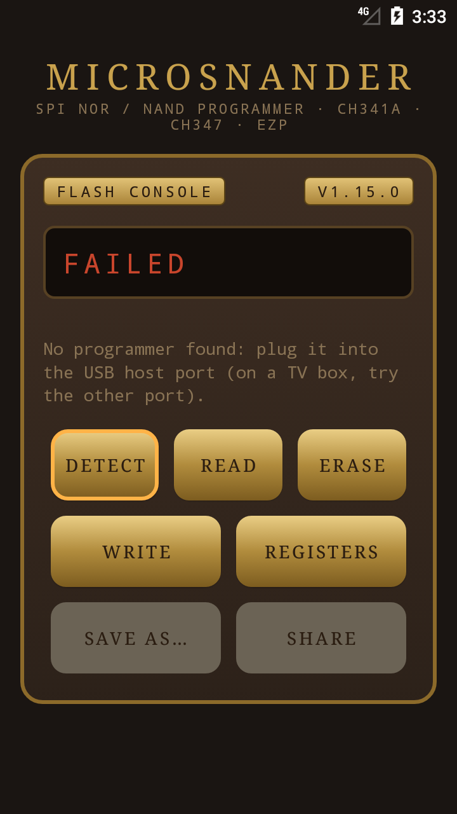
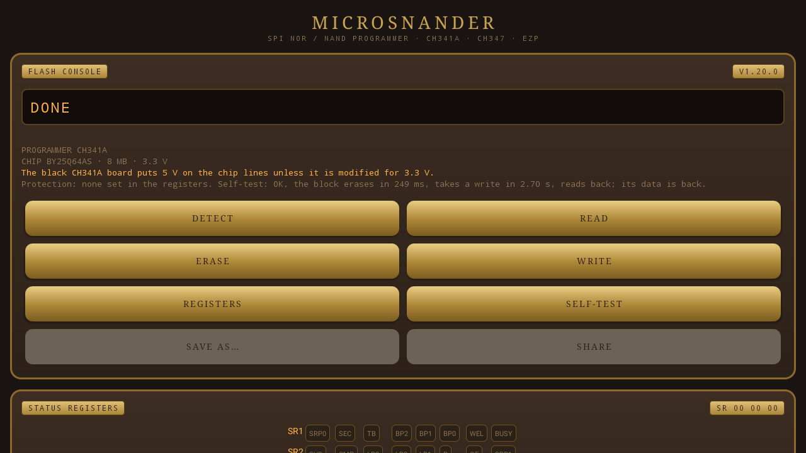

![OpenIPC logo][logo]

# MicroSNANDer

[English](README.md) | [Русский](README.ru.md) | **简体中文**

[](https://github.com/OpenIPC/microsnander/actions/workflows/build.yml)
[](https://github.com/OpenIPC/microsnander/releases/latest)
[](LICENSE)
[](https://github.com/OpenIPC/microsnander)
[](#系统要求)

MicroSNANDer 是一个命令行编程器，配合廉价的 CH341A、CH347 和 EZP USB 编程器使用，用于 SPI NOR 和
SPI NAND 闪存芯片。它可以读取、写入、擦除和校验摄像机、路由器及其他开发板的闪存，
解除 SPI NOR 芯片的写保护，支持 291 款 SPI NOR 和 135 款 SPI NAND 芯片。

它是 McMCC 的 [SNANDer](https://github.com/McMCCRU/SNANDer) 1.7.4 经过精简、增强、深度修改和优化的版本：
仅支持 Linux，不支持 EEPROM，增加了 `-u`（解除保护）命令以及 OpenIPC
硬件上常见的闪存芯片。发布的二进制文件为静态链接、无任何依赖，同一个文件既可以在
PC 上运行，也可以直接在 USB 口插着编程器的 ARM 摄像机上运行。

更新记录：[CHANGELOG.md](CHANGELOG.md)。

## 快速开始

```sh
# 1. 下载静态二进制文件（arm：microsnander-linux-arm）
curl -fLo microsnander https://github.com/OpenIPC/microsnander/releases/latest/download/microsnander-linux-x86_64
chmod +x microsnander

# 2. 插上带芯片的编程器，识别芯片
sudo ./microsnander -i

# 3. 备份整片芯片，然后写入新镜像并校验
sudo ./microsnander -r backup.bin
sudo ./microsnander -w firmware.bin -v
```

## 目录

- [快速开始](#快速开始)
- [系统要求](#系统要求)
- [编程器对比](#编程器对比)
- [发布与固定链接](#发布与固定链接)
- [用法](#用法)
- [示例](#示例)
- [Web 模式](#web-模式)
- [Android 应用](#android-应用)
- [支持的芯片](#支持的芯片)
- [芯片电压](#芯片电压)
- [数据不确定的芯片](#数据不确定的芯片)
- [构建](#构建)
- [致谢](#致谢)
- [许可证](#许可证)
- [支持](#支持)

## 系统要求

- 配有芯片座或夹子的 USB 编程器：
  - CH341A（USB ID `1a86:5512`），处于 SPI 模式（编程器板上的跳线）。常见的黑色 CH341A
    板数据线电平为 5 V：3.3 V 芯片请使用改装为 3.3 V 的板或电平转换器，1.8 V 芯片请使用
    1.8 V 转接板。
  - CH347T（`1a86:55db`），处于模式 1（UART + SPI + I2C，由模式开关或跳线设置），或
    CH347F（`1a86:55de`）。速度远快于 CH341A（16 MB 芯片约 7 秒读完）；SPI 时钟为 30 MHz，可用 `-S` 修改。
  - EZP2019、EZP2019+ 或 EZP2023（USB `1fc8:310b`、`1fc8:310c` 或 `1fc8:310d`），用于 16 MB 及以下的
    SPI NOR 芯片。这些编程器由自身固件驱动 SPI 总线，只接受完整的操作，因此使用它们时：
    - `-r`、`-w` 和 `-v` 与其他编程器相同（16 MB 芯片约 2 分 15 秒读完）；
    - `-e` 只能擦除整片芯片：不要带 `-a` 和 `-l`，擦除部分区域会被拒绝；
    - `-w` 只写入已擦除的区域：先读取该区域，若已有数据则拒绝写入；
    - 状态寄存器既不能读也不能写：没有 `-u`，识别芯片时也不显示它们；
    - 不支持 SPI NAND。

  只连接一个编程器时 microsnander 直接使用它；连接多个时请用 `-P ch341a`、`-P ch347` 或 `-P ezp`
  选择。占用编程器的内核驱动（例如 `spi-ch341`）会在运行期间分离，结束后重新绑定。
- x86_64 或 32 位 ARM（ARMv5TE 及以上）上的 Linux。发布的二进制文件为静态链接（musl），
  不使用 libusb：microsnander 自己通过 Linux usbfs（`/dev/bus/usb`）访问编程器。无需安装任何东西。
- USB 设备访问权限：以 root 运行，或用 udev 规则授权给某个用户组（之后重新插拔编程器）：

  ```sh
  sudo tee /etc/udev/rules.d/60-microsnander.rules <<'EOF'
  SUBSYSTEM=="usb", ATTR{idVendor}=="1a86", ATTR{idProduct}=="5512", MODE="0660", GROUP="plugdev"
  SUBSYSTEM=="usb", ATTR{idVendor}=="1a86", ATTR{idProduct}=="55db", MODE="0660", GROUP="plugdev"
  SUBSYSTEM=="usb", ATTR{idVendor}=="1a86", ATTR{idProduct}=="55de", MODE="0660", GROUP="plugdev"
  SUBSYSTEM=="usb", ATTR{idVendor}=="1fc8", ATTR{idProduct}=="310b", MODE="0660", GROUP="plugdev"
  SUBSYSTEM=="usb", ATTR{idVendor}=="1fc8", ATTR{idProduct}=="310c", MODE="0660", GROUP="plugdev"
  SUBSYSTEM=="usb", ATTR{idVendor}=="1fc8", ATTR{idProduct}=="310d", MODE="0660", GROUP="plugdev"
  EOF
  sudo usermod -aG plugdev "$USER"
  sudo udevadm control --reload-rules && sudo udevadm trigger
  ```

## 编程器对比

使用 microsnander 1.14.1 在 Linux 上测得，每个编程器中为同一型号芯片（Winbond W25Q128，16 MB）：
整条命令从开始到 `Status: OK` 的时间。EZP 编程器在写入前会先读取该区域，检查其是否已擦除。

|                              | CH341A      | CH347T / CH347F                   | EZP2019 / EZP2019+ / EZP2023    |
|------------------------------|-------------|-----------------------------------|---------------------------------|
| USB ID                       | `1a86:5512` | `1a86:55db`、`1a86:55de`          | `1fc8:310b`、`310c`、`310d`     |
| SPI 时钟                     | 固定        | 1.875–60 MHz（`-S`），默认 30 MHz | 由其固件设定                    |
| SPI NOR                      | 是          | 是                                | 最大 16 MB                      |
| SPI NAND                     | 是          | 是                                | 否                              |
| 擦除芯片的一部分             | 是          | 是                                | 否，只能整片擦除                |
| 解除保护（`-u`）、状态寄存器 | 是          | 是                                | 否                              |
| 整片擦除，16 MB              | 48 秒       | 33 秒                             | 37 秒                           |
| 读取 16 MB                   | 136 秒      | 7.2 秒（60 MHz 下 5.2 秒）        | 136 秒                          |
| 写入 16 MB                   | 256 秒      | 152 秒                            | 275 秒（其中 136 秒为擦除检查） |

## 发布与固定链接

只有一个发布：[`latest`](https://github.com/OpenIPC/microsnander/releases/latest)。
每次推送到 `main` 且所有构建通过后，CI 会重新生成它；标题中带有版本号
（`Microsnander X.Y.Z`），不保留按版本的发布。文件名中不含版本号，因此下面的链接
始终指向最新构建：

| 文件                                                                                                                      | 适用于                                                                 |
|---------------------------------------------------------------------------------------------------------------------------|------------------------------------------------------------------------|
| [`microsnander-linux-x86_64`](https://github.com/OpenIPC/microsnander/releases/latest/download/microsnander-linux-x86_64) | PC 和服务器                                                            |
| [`microsnander-linux-arm`](https://github.com/OpenIPC/microsnander/releases/latest/download/microsnander-linux-arm)       | 32 位 ARM：摄像机、树莓派及其他开发板（soft-float，有无 FPU 均可运行） |
| [`microsnander-android.apk`](https://github.com/OpenIPC/microsnander/releases/latest/download/microsnander-android.apk)   | Android 5.0 及以上：带 USB 主机端口的手机和电视盒子，无需 root         |

发布页面：`https://github.com/OpenIPC/microsnander/releases/latest`

## 用法

```
microsnander [options]

 -h             display this message
 -d             disable internal ECC (use read and write page size + OOB size)
 -I             ECC ignore errors (for read test only)
 -k             skip BAD pages (SPI NAND): use the next page instead
 -L             print list support chips
 -i             read the chip ID info
 -e             erase chip (full or use with -a [-l])
 -l <bytes>     manually set length
 -a <address>   manually set address
 -w <filename>  write chip with data from filename
 -r <filename>  read chip and save data to filename
 -u             unprotect chip
 -v             verify after write on chip
 -P <name>      programmer: ch341a, ch347, ezp, auto (default: the one connected)
 -S <speed>     SPI clock of the CH347: 60M, 30M (default), 15M, 7.5M, 3.75M, 1.875M
 -W [addr:]port web mode: a page with Detect, Read, Erase, Write, Registers
 -K <password>  web mode: ask for this password (any user name)
 -o <dir>       web mode: where Read saves the dumps (default: the current one)
```

每次运行只执行一个操作：`-i`、`-e`、`-r`、`-w` 或 `-u`。不指定 `-a` 和 `-l` 时，
操作覆盖整片芯片。地址和长度可以是十进制，或带 `0x` 的十六进制。擦除按整块进行：
长度必须是芯片报告的块大小的整数倍。

SPI NAND 芯片默认使用片内 ECC 读写：文件中只有数据页。使用 `-d` 时关闭 ECC，每页
连同 OOB（spare）区一起读写，用于原始转储。

使用 `-k` 时，读取时 ECC 失败或写入失败的页会被跳过，数据从下一页继续，因此其后的
内容整体后移一页；每个被跳过的页都会打印出来。写入不会超出 `-a`/`-l` 的范围（不指定
`-l` 时到芯片末尾）：请用 `-l` 指定分区大小，分区内空间不够的写入会失败。需要用到芯片
末尾之后的页的读取也会失败。
写入失败的页只在同一次运行的 `-v` 中被记住：之后用 `-k` 读取时可能把它当作数据读出，
转储从该页起会错位。

## 示例

```sh
# 芯片 ID、型号和容量
microsnander -i

# 完整备份
microsnander -r full.bin

# 从 0x50000 读取 1 MiB（例如内核分区）
microsnander -r kernel.bin -a 0x50000 -l 0x100000

# 写入完整镜像并校验
microsnander -w full.bin -v

# 只把 U-Boot 写到芯片开头
microsnander -w u-boot.bin -a 0 -v

# 擦除 0x40000 处的 64 KiB（大多数 SPI NOR 芯片的一个块）
microsnander -e -a 0x40000 -l 0x10000

# SPI NOR 芯片无法擦除或写入：先解除保护
microsnander -u

# SPI NAND：带 OOB 区的原始转储，关闭 ECC
microsnander -d -r raw.bin
```

## Web 模式

`-W [地址:]端口` 让 microsnander 作为服务运行：在浏览器中打开一个与其他 OpenIPC 工具风格一致的页面，
为已连接的编程器提供 Detect、Read、Erase、Write 和 Registers 按钮。

<p align="center">
  
  
</p>

```sh
microsnander -W 8080                       # 所有网络接口，端口 8080
microsnander -W 127.0.0.1:8080 -K secret   # 仅本机访问，并设置密码
microsnander -P ch347 -W 8080 -o /srv/dumps
```

页面：

- **指示灯**：Link（页面能连到服务）、Programmer、Chip、Busy。
- **表盘和显示屏**：操作进度（百分比）和状态（Reading、Writing、Verifying、Erasing、Saved、Written、
  Erased、Failed）；下方是编程器、芯片及其容量、最近的转储和最近的消息。
- **Detect**：查找编程器和芯片，并读取状态寄存器。
- **Read**：将整片芯片读入 `-o` 目录（默认为当前目录）中的文件，浏览器同时下载，链接保留在页面上。
  启动时指定了 `-a`/`-l` 时，读取该区域。
- **Erase**：确认后擦除整片芯片。
- **Write**：在浏览器中选择的文件（引导程序或完整镜像）从地址 0 写入已擦除的芯片，然后读回比较。
  请先擦除。文件不会保存在内存中：写入前它以无名文件的形式存放在 `-o` 目录中，因此最大 512 MB 的
  镜像需要该目录有同样大小的可用空间。
- **Registers**：状态寄存器 1–3 的每一位一个指示灯（位名称与 Winbond 类芯片相同；琥珀色为保护位，
  绿色为其他位），以及 **Clear protection**，与 `-u` 相同：清除 BP、SRP 和 CMP，保留 QE。仅限通过
  CH341A 或 CH347 操作 SPI NOR；EZP 编程器无法读取寄存器。

文件名：`flash-YYYYMMDDHHMM-芯片.bin`，使用运行服务的机器的本地时间，例如
`flash-202611031706-W25Q128BV.bin`。使用 `-a`/`-l` 时会加上区域：
`flash-202611031706-W25Q128BV-0x50000-0x100000.bin`。同一分钟内的第二次读取不会覆盖第一次，
而是加上 `-2`、`-3` 等。

工作方式：

- 只使用一个编程器，选择方式与不带 `-W` 时相同；连接了多个时请用 `-P`。
- 每个操作开始时打开编程器、结束后关闭，因此两次操作之间可以重新插拔，或用普通方式运行 microsnander。
- 每次只运行一个操作；操作进行中的请求会得到 `409`。操作进行时页面每秒查询两次状态。
- `-d`、`-I` 和 `-k` 不能与 `-W` 一起使用：页面在开启 ECC 的情况下从地址 0 写入完整文件。
- 客户端断开时服务继续运行；慢速客户端不会阻塞其他客户端（最多同时 16 个连接）。

访问：

- 不带 `-K` 时，任何能访问该端口的人都可以擦除芯片。带 `-K` 时浏览器会要求输入密码（用户名任意）；
  空密码会被拒绝。
- 页面使用普通 HTTP，密码以明文在网络上传输：请在可信网络中使用，或使用 `-W 127.0.0.1:8080` 加
  SSH 隧道。
- 操作需要一个只有本页面才会发送的请求头，因此其他网站的页面无法发起擦除或写入。请求必须通过 IP
  地址、`localhost` 或本机主机名访问本机（不接受其他名称：防止 DNS rebinding）。
- `-o` 目录中只提供 Read 生成的转储文件，绝不提供指向其他文件的链接。

作为 systemd 服务运行（用户需在上面 udev 规则中的 `plugdev` 组内）：

```ini
# /etc/systemd/system/microsnander.service
[Unit]
Description=microsnander web mode
After=network.target

[Service]
ExecStart=/usr/local/bin/microsnander -W 8080 -K <password> -o /var/lib/microsnander
User=microsnander
Group=plugdev
StateDirectory=microsnander
Restart=on-failure

[Install]
WantedBy=multi-user.target
```

## Android 应用

`android/` 是一个与 Web 模式按钮相同的应用（Detect、Read、Erase、Write、Registers），用于连接在
手机或 Android TV 盒子 USB 主机端口上的 CH341A、CH347 或 EZP 编程器（Android 5.0 及以上，无需
root；在电视盒子上会出现在主屏幕，可用遥控器操作）。

<p align="center">
  
  
</p>

- 插上编程器（手机需通过 OTG 转接头；电视盒子的某个端口可能只能作为设备端口，请换另一个），并允许
  应用使用它。
- **Read** 将 `flash-YYYYMMDDHHMM-芯片.bin` 保存到“下载”；**Save as…** 可保存到任意位置，**Share**
  可发送给其他应用。
- **Write** 通过文件选择器选取文件，从地址 0 写入已擦除的芯片，然后校验；文件分段读取，不会整个载入内存。**Erase** 擦除整片芯片。
- **Registers** 和 **Clear protection** 与 Web 模式相同（通过 CH341A 或 CH347 操作 SPI NOR）。
- 应用使用与 microsnander 相同的 C 代码（`src/`），由 NDK 编译，访问 Android USB 管理器打开的
  设备（通过其文件描述符和 usbfs 代码，不使用 libusb）。签名的 APK 在发布版中：[latest](https://github.com/OpenIPC/microsnander/releases/latest) 里的 `microsnander-android.apk`。

构建：在安装了 Android SDK 和 NDK r27c 的环境中运行 `cd android && gradle assembleDebug`。

## 支持的芯片

`microsnander -L` 会列出支持的芯片：291 款 SPI NOR 芯片（Winbond、Eon、Fudan
Microelectronics FM25Q、GigaDevice、Macronix、Spansion、XMC、XTX、Zbit、Giantec
GM25Q、ISSI、Micron、Boya、Puya 等）和 135 款 SPI NAND 芯片（Etron、GigaDevice、Heyang、Foresee、ESMT、Dosilicon、XTX、Micron、
Toshiba/Kioxia、Winbond、Macronix 等）。不在列表中的芯片会显示为未检测到；输出中的
芯片 ID 可用于添加该芯片。

## 芯片电压

编程器工作在 3.3 V。编程器不测量电压，所以 microsnander 根据芯片型号判断：列表中有 56 款
SPI NOR 芯片是 1.8 V 型号（GigaDevice GD25L、Macronix MX25U、Winbond W25Q..W、Micron
N25Q..A11 和 MT25QU、XMC XM25QU 和 XM25LU、Zbit ZB25LQ、Boya BY25Q..L、ISSI IS25WP），
还有 20 款 SPI NAND 芯片也是（GigaDevice GD5F..R、Winbond W25N..W、Macronix MX35UF、Micron
MT29F..ABB、ESMT F50D、Dosilicon DS35M）。这些芯片要通过 1.8 V 转接板连接：在 3.3 V 下读取
不可靠，芯片也可能损坏。GigaDevice GD25W、XMC XM25QW 和 Fudan FM25W 支持 1.65-3.6 V，
可以直接连接。

找到 1.8 V 芯片后，控制台会输出警告，网页会把 Chip 指示灯点成红色并显示警告，Android 应用
也一样；`/api/state` 中有 `voltage`（`3.3`、`1.8`、`1.65-3.6`）和 `warning` 字段。不在这些
列表中的芯片按 3.3 V 处理。

没有 5 V 的 SPI flash 芯片。但黑色 CH341A 板如果没有改成 3.3 V，会在芯片引脚上输出 5 V，
程序无法检测到这一点：使用 CH341A 时，microsnander 每次找到芯片都会提醒。

## 数据不确定的芯片

对于下列 SPI NOR 和 SPI NAND 芯片，其他来源给出的参数与 MicroSNANDer 使用的不同。这些芯片都还没有
在硬件上验证过，因此读取、写入，尤其是原始转储（`-d`）的结果可能与这里的描述不同。如果
您有这些芯片，请在 [GitHub Issues](https://github.com/OpenIPC/microsnander/issues)
中报告其工作情况，并附上 `microsnander -i` 的输出和芯片上的完整型号。

| 芯片                                                       | MicroSNANDer 使用                                                                | 其他来源                              |
|------------------------------------------------------------|----------------------------------------------------------------------------------|---------------------------------------|
| TOSHIBA TC58CVG0S3H, TC58CVG1S3H                           | OOB 128 字节                                                                     | OOB 64 字节                           |
| TOSHIBA TC58CVG2S0H, KIOXIA TC58CVG2S0HRAIJ                | OOB 256 字节                                                                     | OOB 128 字节                          |
| MICRON MT29F4G01（ID `2C 36`）                             | 两个 2 Gbit 晶粒，页 2 KB，OOB 128 字节                                          | 单晶粒，页 4 KB，OOB 256 字节         |
| 厂商 ID 为 `C9` 的 HEYANG 芯片                             | 状态位 5:4 为 `10` 表示 ECC 不可纠正；解锁清除位 5:3                             | 位 5:4 为 `11`；解锁位 6:3            |
| DOSILICON DS35Q1GA, DS35Q2GA                               | 状态位 5:4 为 `10` 表示 ECC 不可纠正                                             | 位 6:4 为 `010`                       |
| GIGADEVICE GD5F1GM7UE                                      | OOB 128 字节，dual 读取                                                          | OOB 64 字节，single 读取              |
| ESMT F50D1G41LB(2M)                                        | OOB 64 字节                                                                      | OOB 128 字节                          |
| FORESEE F35SQA001G                                         | OOB 64 字节                                                                      | OOB 128 字节                          |
| FORESEE F35SQA512M                                         | dual 读取                                                                        | single 读取                           |
| XINCUN XCSP1AAWH-NT                                        | 不检查 ECC 状态：不可纠正的页读取时不报错                                        | 状态编码未知                          |
| UNIM UM19C0HISW                                            | 暂不支持                                                                         | spare 区计入页和块大小的几何参数      |
| ES25P10–ES25P32、ES25M40A–ES25M16A（SPI NOR）              | 按 ID 中的容量字节确定大小（ES25P10：1 Mbit）                                    | 两倍大小                              |
| ISSI `9D 60 1A`、`9D 70 1A`（SPI NOR）                     | IS25LP512M、IS25WP512M，512 Mbit                                                 | 命名为 IS25LP256D、IS25WP256D         |
| PCT25VF020B–PCT25VF032B、PCT26VF016、PCT26VF032（SPI NOR） | AAI 字编程（SST25 类型）、ULBPR 解锁和 4 KB 擦除（SST26 类型）；在 CH341A 上较慢 | 作为支持 256 字节页编程的普通芯片列出 |
| PCT25VF010A（SPI NOR）                                     | 不支持：没有 JEDEC READ ID                                                       | 列有 JEDEC ID                         |

OOB 大小只影响使用 `-d` 的原始转储（每页连同 spare 区一起读取）；使用片内 ECC 的读写只
涉及数据区。原始写入只接受完整的“数据 + OOB”页，因此 1.11.1 之前（使用旧 OOB 大小）
制作的上述 Toshiba/Kioxia 芯片原始转储会被拒绝：请先把每页用 `0xFF` 补齐到新的 OOB 大小。

## 构建

本机构建（Debian、Ubuntu）：不需要任何库，`src/usbfs.c` 通过 Linux usbfs 访问编程器：

```sh
sudo apt-get install build-essential
make -C src
```

`make -C src LIBUSB=1` 改为基于 libusb-1.0 构建（`libusb-1.0-0-dev`），用于对比。

不支持 I2C（24Cxx）和 Microwire（93Cxx）EEPROM 芯片：microsnander 用于 SPI NOR 和 SPI NAND
闪存。原版 SNANDer 的 EEPROM 部分（`-E`、`-8`、`-f`）已删除。

静态发布文件由 `ci/build-musl.sh` 构建（Docker 或任何带 `curl`、`make` 的 x86_64
Linux，arm 还需要 `qemu-user`）。脚本会下载 musl 工具链并按 SHA256 校验：

```sh
ci/build-musl.sh x86_64 dist    # dist/microsnander-linux-x86_64
ci/build-musl.sh arm dist       # dist/microsnander-linux-arm
```

## 致谢

MicroSNANDer 基于 McMCC 的 [SNANDer](https://github.com/McMCCRU/SNANDer)
（Serial Nor/nAND/Eeprom programmeR），而 SNANDer 使用了 flashrom 和 ch341eeprom 的
CH341A 代码。源文件中保留了原始版权声明。

## 许可证

[GPL-2.0](LICENSE)，与原版 SNANDer 相同。完整条款见 [LICENSE](LICENSE)。

## 支持

- 问题与错误报告：[GitHub Issues](https://github.com/OpenIPC/microsnander/issues)
- 文档：[openipc.org](https://openipc.org)

[](https://openipc.org/our-channels)

[logo]: https://raw.githubusercontent.com/OpenIPC/.github/refs/heads/main/assets/openipc-logo-black.svg
